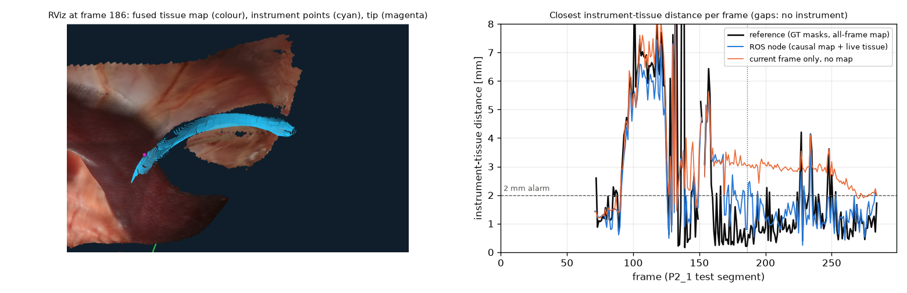

# semantic-recon3d

Stereo endoscopy → semantic 3D map of the surgical scene → live instrument-to-tissue distance in ROS 2,
on one laptop GPU (RTX 5060 Laptop, 8 GB). Data: StereoMIS (da Vinci Xi, in-vivo porcine).
Evaluation protocol: train on P2_0, P2_2–P2_8; tune on P1; test on P3 (segmentation) and the held-out
P2_1 segment (fusion, proximity). Every number below comes from a file under `outputs/` produced by the
scripts listed in the stage docs.

| Stage | Result | Doc |
|---|---|---|
| 1–2 Environment, data | Six silent dataset problems found and fixed before training: video seeking, mask coordinates, mask numbering, mask encodings, trocar frames, P3 fluorescence mode | [DATA_NOTES](docs/DATA_NOTES.md), [SETUP](docs/SETUP.md) |
| 3 Depth | RAFT stereo: 0.52 mm cross-frame consistency, 93% coverage; SGBM 0.69 mm; Depth Anything V2 large 0.94 mm | – |
| 3 Pose | Stereo VO 3.8 mm ATE (scale 1.01) vs COLMAP 6.9 mm and VGGT 5.6 mm (both after Sim(3), wrong metric scale) | – |
| 4 Segmentation | SegFormer-B2 P3 test IoU 0.805 (fluorescence 0.034 → 0.686 with simulated fluorescence) | [SEGMENTATION](docs/SEGMENTATION.md) |
| 4 Tracking | SAM 2 large: P3 flicker 0.061 → 0.044 (ground truth 0.041), IoU 0.801 → 0.788: stability, not accuracy | [SEGMENTATION](docs/SEGMENTATION.md) |
| 5 Fusion | Gaussian splatting 23.1 dB / 0.71 mm vs TSDF 19.1 dB / 0.82 mm on 37 held-out views; voted 3D labels IoU 0.98 vs 0.90 single-frame | [FUSION](docs/FUSION.md) |
| 6 ROS 2 node | Instrument-tissue distance MAE 0.85 mm vs a ground-truth-mask reference; alarm < 2 mm recall 0.85 / precision 0.87 | [ROS](docs/ROS.md) |
| 7 Deployment | TensorRT FP16: 102 ms per frame end to end (PyTorch 244 ms); the ROS node sustains 9.2 Hz on the 30 Hz camera stream (120 ms latency), accuracy unchanged | [DEPLOY](docs/DEPLOY.md) |



## Layout

```
sr3d/data        canonical scene format, StereoMIS converter, poses
sr3d/depth       RAFT stereo, SGBM, Depth Anything V2
sr3d/pose        stereo VO, COLMAP, VGGT wrappers
sr3d/segmentation SegFormer, fluorescence simulation, SAM 2 tracking
sr3d/fusion      TSDF (Open3D VoxelBlockGrid), Gaussian splatting (gsplat), multi-view label voting
sr3d/ros         proximity core (no ROS), online pipeline, ROS 2 node and player, message conversions
sr3d/deploy      ONNX export, TensorRT engines and runners
scripts/         one script per experiment; launch/ ROS 2 launch + RViz config; docker/ Dockerfile (unbuilt)
tests/           geometry, data conventions, metrics, augmentation, tracking, fusion, proximity
```

## Honest caveats

* P2_1 (fusion / proximity test segment) is the same animal as the segmentation training data.
* The proximity reference shares the stereo depth with the system under test; it is not measured ground truth.
* The P2_1 proximity test was scored three times while the tuning set was fixed; all three are in `docs/ROS.md`.
* The Dockerfile has not been built (no Docker on the development machine).
