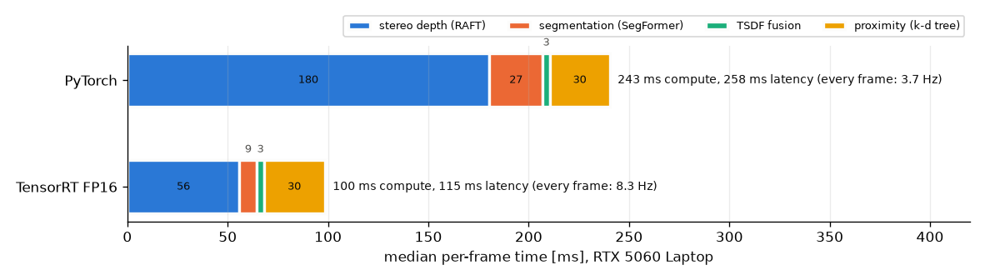

# Deployment: TensorRT and Docker (Stage 7)

```
python scripts/export_trt.py --out outputs/deploy                           # ONNX + TensorRT engines (fp16, fp32)
python scripts/benchmark_deploy.py data/scenes/stereomis_P2_1_tools         # accuracy parity + latency
ros2 launch launch/proximity.launch.py backend:=tensorrt                    # node on the engines (sr3d-ros env)
```

The two per-frame networks are exported with fixed 640×512 inputs (`sr3d/deploy/engines.py`):
SegFormer-B2 returns the full-resolution instrument probability; RAFT returns the final flow for the batched
(left→right, right→left) pair, so the left-right consistency check stays in the same Python code as the
PyTorch path. TensorRT 11 only builds strongly typed networks, so precision comes from the ONNX graph: the
FP16 graph is converted after export with ONNX's float16 converter, keeping I/O in float32.

**RAFT needs mixed precision.** Its pixel coordinates reach ~80 at 1/8 resolution, where float16 steps are
1/16, i.e. 0.5 px at full resolution: rounding of up to 0.25 px on a ~26 px disparity (9 cm depth, 4.16 mm
baseline), about 1% of depth (estimate, not measured). Element-wise coordinate
arithmetic and grid sampling therefore stay float32; convolutions and the correlation run in float16.

## Results (RTX 5060 Laptop, TensorRT 11.4, 60 frames of P2_1 for accuracy, 100 timed calls after 20 warm-up)

Latency per call includes pre- and post-processing (numpy in, numpy out), CUDA synchronised.

| Network | Backend | Latency median (P90) | Accuracy vs PyTorch |
|---|---|---|---|
| RAFT stereo (12 iterations) | PyTorch FP32 | 177 ms (181) | reference |
| | TensorRT FP32 (before fix) | 114 ms (116) | **not usable**: median 0.32 mm, P99 3.9 mm, validity agreement 79.6% |
| | **TensorRT FP16 (mixed)** | **51 ms (54)** | median 0.046 mm, P99 0.39 mm, validity agreement 99.8% |
| SegFormer-B2 | PyTorch (bf16 autocast) | 25.7 ms (36.3) | IoU vs ground truth 0.9406 |
| | TensorRT FP32 | 19.2 ms (19.6) | IoU vs GT 0.9405, vs PyTorch 0.9997 |
| | **TensorRT FP16** | **8.5 ms (9.6)** | IoU vs GT 0.9405, vs PyTorch 0.9997 |
| SAM 2.1 large propagation | PyTorch | 176 ms / frame | offline video mode, not exported (not used by the node) |

IoU here is the mean per-frame IoU over frames with an instrument (60 frames, every 5th), a different
average from the pooled pixel IoU in `FUSION.md`.

**End to end** (`ProximityPipeline.step`: depth, segmentation, fusion, proximity; 140 consecutive frames):
PyTorch 244 ms median (P90 277), TensorRT FP16 102 ms (P90 131), + GPU nearest-neighbour search 87 ms
(P90 101), + instrument shape prior 99 ms (P90 119). In the ROS node: 243 → 100 ms compute, 258 → 115 ms
latency, 3.7 → 8.3 Hz every-frame rate; 9.2 Hz on the 30 Hz camera stream, 10.3 Hz with GPU nearest
neighbours, 8.2 Hz with the shape prior (node default; `ROS.md`). Proximity accuracy is unchanged on
TensorRT: MAE 0.854 mm vs 0.850 mm (PyTorch) against the reference. Re-measured on 2026-11-05: PyTorch RAFT
178 ms, FP16 51-55 ms, FP32 115 ms (the same as on 2026-11-04 within 3 ms).



**The RAFT FP32 engine was wrong, not slow; fixed by pinning the correlation volume.** The FP32 ONNX graph
is correct (ONNX Runtime reproduces PyTorch to 0.0005 px), but TensorRT 11.4's FP32 build returned P99 flow
errors of ~20-29 px. Bisection on a real P2_1 pair (`build_engine` docstring):

| Test (TensorRT FP32 vs ONNX Runtime, P99 flow error) | Result |
|---|---|
| 1 / 2 refinement iterations | 0.22 / 0.17 px (correct) |
| 3 / 4 / 12 iterations | 23 / 21 / 29 px (wrong) |
| builder optimisation level 0, 1, 2, 4, 5 (4 iterations) | all wrong (level 0: 72 px) |
| all `GridSample` outputs marked as network outputs | correct (max 0.23 px) |
| only level-0 lookups marked (levels 1-3 not) | correct; marking any other single level: wrong |
| only the correlation volume (`MatMul` -> `Reshape`, read by every level-0 lookup) marked | **correct** |
| only the iteration-3 lookup marked | worse (P99 106 px) |

The full-resolution correlation volume is computed once and read by every iteration; the result is right
while it is read only twice, and marking it as an output (a dedicated buffer for the whole inference) makes
it right. That pattern fits the volume's memory being reused while still needed; it was not confirmed inside
TensorRT (closed source). `export_trt.py` now pins it for both RAFT engines (`--no-pin` reproduces the bug).

| RAFT engine (P2_1 frame 100, 12 iterations, vs ONNX Runtime) | Median | P99 | Max |
|---|---|---|---|
| TensorRT FP32, before | 0.21 px | 20.4 px | 21.7 px |
| **TensorRT FP32, pinned** | **0.003 px** | **0.021 px** | **0.07 px** |
| TensorRT FP16 mixed, before / pinned | 0.028 / 0.029 px | 0.155 / 0.168 px | 0.74 / 1.05 px |

**Pin only FP32.** Pinning in the FP16 engine is not needed (same accuracy as unpinned) and costs 2.7 ms
(54.8 vs 52.1 ms: the pinned tensor is written out every call), so `export_trt.py` pins the FP32 engine only.

## GPU nearest-neighbour search

After TensorRT, the k-d tree proximity step (30 ms, CPU) was the second-largest cost after depth; about half
of it was building a k-d tree over the live frame's ~80k tissue points every frame. `sr3d/ros/gpu_nn.py`
replaces the trees with an exact brute-force search in one Triton kernel (running minimum per instrument
point, the distance matrix is never stored; squared distances from coordinate differences, so no
cancellation at sub-millimetre gaps; tissue outside the instruments' box grown by the search bound is
skipped). Distances match the k-d tree to 0.011 um over all 300 P2_1 frames (unit-tested against cKDTree).
Proximity 30 → 19 ms, end to end 101 → 87 ms. Triton compiles the kernel at start-up and needs a C compiler
(`gcc_linux-64` in the conda envs, `build-essential` in the Dockerfile); without one the pipeline warns and
falls back to the CPU trees.

## Docker

`docker/Dockerfile` (ROS 2 Jazzy base, CUDA 12.8 PyTorch wheels, TensorRT 11.4, the node and launch files).
**It has not been built or run**: this machine has no Docker and no sudo. It mirrors the conda setup that
was run. TensorRT engines are specific to the GPU and TensorRT version, so they are built inside the
container (`scripts/export_trt.py`), not copied in.

## Environment

| | |
|---|---|
| GPU | NVIDIA RTX 5060 Laptop (8 GB, compute 12.0), driver 592.82, WSL2 Ubuntu 26.04 |
| `sr3d` env | Python 3.11, PyTorch 2.11 + CUDA 12.8, Open3D 0.20, TensorRT 11.4 |
| `sr3d-ros` env | RoboStack ROS 2 Jazzy, Python 3.12, same PyTorch / Open3D / TensorRT |

Note: the Stage 3 depth benchmark logged 523 ms per RAFT frame (`outputs/depth/.../summary.json`); the
controlled measurement here (warm, synchronised, plugged in) is 177 ms. The earlier figure was a whole-run
average and was not a controlled latency measurement; its conditions (power state, I/O) were not recorded.
