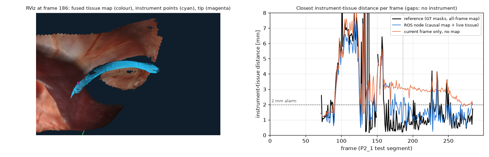

# ROS 2 proximity node (Stage 6)

A ROS 2 Jazzy node that turns stereo video and the robot's kinematic camera pose into the number a virtual
fixture or safety monitor needs: the distance between each instrument and the tissue, every frame.

```
conda activate sr3d-ros                                              # RoboStack ROS 2 Jazzy + torch + TensorRT
ros2 launch launch/proximity.launch.py rate:=15.0 backend:=tensorrt rviz:=true
ros2 launch launch/proximity.launch.py lockstep:=true                # process every frame (no drops)
python scripts/eval_proximity.py data/scenes/stereomis_P2_1_tools    # accuracy (sr3d env, cached depth/masks)
python scripts/ros_latency_report.py outputs/ros/lockstep_*.csv outputs/ros/realtime15_*.csv
bash scripts/capture_rviz.sh 187 docs/figures/ros_rviz_raw.png       # needs a display with OpenGL (WSLg works)
```

## Interface

| Topic | Type | Content |
|---|---|---|
| `/stereo/{left,right}/image_rect` (in) | `sensor_msgs/Image` | rectified rgb8 pair, same stamp |
| `/stereo/left/pose` (in) | `geometry_msgs/PoseStamped` | kinematic camera pose in `world`, same stamp |
| `/stereo/right/camera_info` (in) | `sensor_msgs/CameraInfo` | K and baseline (P[0,3] = -fx·B) |
| `/sr3d/min_distance` | `sensor_msgs/Range` | closest instrument-tissue distance, +inf when no instrument |
| `/sr3d/tool_tips` | `geometry_msgs/PoseArray` | instrument tips (world) |
| `/sr3d/proximity` | `visualization_msgs/MarkerArray` | tips, closest-point lines (red < 2 mm, amber < 5 mm), distance text |
| `/sr3d/instrument_cloud` | `sensor_msgs/PointCloud2` | current instrument surface (world) |
| `/sr3d/semantic_cloud` | `sensor_msgs/PointCloud2` | current frame x y z rgb label confidence (camera frame) |
| `/sr3d/tissue_map` | `sensor_msgs/PointCloud2` | fused tissue surface with colour (world), on each map refresh |

`sr3d/ros/player.py` replays a converted scene the way a robot would publish it. The node
(`sr3d/ros/node.py`) is a thin wrapper around `sr3d/ros/pipeline.py` (pure Python, no ROS), so the offline
evaluation replays exactly the code the node runs. Image queues are one deep: when perception is slower than
the camera the node takes the newest frame and drops the rest instead of falling behind.

## Method

Per frame: RAFT stereo depth → SegFormer instrument mask → integrate tissue depth (instrument dilated by
5 px) into the TSDF → every 10th frame, rebuild a k-d tree from the map's surface points → per instrument
(connected component of the mask): the 3D tip and the distance to tissue.

* **Tissue = fused map + current frame.** The live frame cannot see the tissue under the tool, which is
  where the distance matters, so the map supplies it. The map only holds frames up to now (causal), so tissue
  the camera has just uncovered is missing; the current frame's own tissue pixels (outside a 12 px margin
  around the instrument) are queried as well.
* **Instrument points** are the stereo depth inside the instrument mask eroded by 1 px away from both the
  mask edge and holes in the depth map. Eroding only the mask edge left a 0.2 mm "contact" made of
  flying pixels at the rim of a depth hole.
* **Distance** is the minimum of the 5×5 median-filtered per-pixel distance image, so it needs a patch of
  the instrument, not one stray pixel. A coarse pass over every 16th point bounds the k-d search; the bounded
  result is exact (unit-tested) and cut the worst frame from 1.9 s to 46 ms.
* **Tip** = the mask pixel farthest from where the instrument enters the image (centroid of its border
  pixels), lifted with the median depth around it; reported only when it is at least 5 px inside the image.

## Evaluation without measured distances

StereoMIS has no measured tool-tissue distance. The reference isolates what the pipeline adds: same RAFT
depth, but ground-truth instrument masks and a tissue map fused from all 300 frames (future included). Hover
frames (reference ≥ 2 mm) and contact frames penalise opposite errors and are reported separately. Alarm
recall/precision: frames where the node and the reference are both below the threshold.

### Tuning on P1 (validation patient), testing on P2_1

The two margins (live-tissue dilation, instrument erosion) were tuned on P1 only. A first tuning window had
the instrument on the tissue almost throughout (reference median 0.19 mm), so it could not penalise reading a
hovering tool as touching; it chose 0 px / 1 px, which failed on P2_1 (row 2 below). The tuning set was then
rebuilt from four P1 windows (frames 8400, 10800, 12600, 16050; 292 hover and 884 contact frames; a fifth
window, 13800, was dropped for missing ground-truth masks) and the objective became the mean of hover and
contact MAE. Grid: dilation 0–16 px × erosion 1–5 px; chosen 12 px / 1 px (P1 objective 1.12 mm vs 1.17 mm
for the initial 5 / 3). P2_1 was therefore scored three times in total; all three are listed.

| P2_1, ROS node configuration | MAE | Hover / contact MAE | Bias | Alarm < 2 mm R / P |
|---|---|---|---|---|
| Initial margins 5 px / 3 px (before any tuning) | 0.84 mm | 0.81 / 0.86 mm | +0.32 mm | 0.80 / 0.90 |
| First P1 tuning, contact-only window: 0 / 1 | 2.69 mm | 6.05 / 0.45 mm | −2.58 mm | 1.00 / 0.64 |
| **Final: balanced P1 tuning, 12 / 1** | **0.85 mm** | **1.10 / 0.68 mm** | **−0.05 mm** | **0.85 / 0.87** |

On P2_1 the final margins trade hover accuracy for contact accuracy and alarm recall; on the balanced
objective they are slightly worse than the initial ones (0.89 vs 0.84 mm). The difference is within the
spread between P1 windows; the margins are not a strong lever.

### Ablations on P2_1 (final margins, 228 frames with a reference distance)

| Variant | MAE | Median | P90 | Bias | Hover / contact | Alarm < 2 mm R / P |
|---|---|---|---|---|---|---|
| **ROS node: SegFormer, causal map + live tissue** | **0.85** | **0.55** | **1.68** | **−0.05** | **1.10 / 0.68** | **0.85 / 0.87** |
| causal map only | 0.94 | 0.56 | 1.91 | +0.14 | 1.06 / 0.86 | 0.80 / 0.88 |
| map k-d tree rebuilt every frame | 0.80 | 0.52 | 1.44 | −0.17 | 1.13 / 0.58 | 0.95 / 0.85 |
| ground-truth masks (online) | 0.85 | 0.50 | 1.81 | −0.04 | 1.08 / 0.70 | 0.81 / 0.89 |
| map from all frames (offline, not causal) | 0.59 | 0.32 | 0.96 | −0.57 | 1.12 / 0.24 | 1.00 / 0.86 |
| current frame only, no map | 1.41 | 1.12 | 2.64 | +0.86 | 1.01 / 1.68 | 0.19 / 0.79 |

All distances in mm. Alarm < 5 mm: recall 0.99, precision 0.94 for the node. Tips: 87 of 90 reference tips
matched (within 50 px), median error 4.0 px / 1.16 mm against tips from ground-truth masks. No frame without
an instrument produced a distance.

* **The map matters where the tool touches tissue**: without it, contact error is 1.68 mm and only 19% of
  close approaches (< 2 mm) raise the alarm; with it, 0.68 mm and 85%.
* **Segmentation is not the bottleneck**: ground-truth masks give the same MAE (0.85 mm). On P2_1 the
  segmenter is in-domain (same animal as training).
* **Causality is**: the all-frame map reaches 0.24 mm on contact frames. The tissue under a tool that stays in
  place is only seen after it moves; an online system cannot have that.
* Rebuilding the tree every frame helps a little (0.80 mm) at extra cost; every 10th frame is kept.



## Runtime (RTX 5060 Laptop, P2_1, 640×512)

Lockstep = the player waits for each answer (every frame processed); real-time = player at a fixed rate.
The scene takes every 2nd frame of a video whose container reports 60 fps, so 30 Hz is the camera rate.
Latency = image stamp to `/sr3d/min_distance` publish. Medians after 5 warm-up frames.

| Backend | Compute / frame | Lockstep latency (median / P90) | Real-time 30 Hz input | Real-time 15 Hz input |
|---|---|---|---|---|
| PyTorch | 243 ms | 258 / 291 ms (3.7 Hz) | 3.9 Hz, 13% of frames, latency 262 / 290 ms | 4.0 Hz, 26% of frames |
| TensorRT FP16 (CPU k-d trees) | 100 ms | 115 / 143 ms (8.3 Hz) | 9.2 Hz, 31% of frames, latency 120 / 147 ms | 9.1 Hz, 61% of frames |
| TensorRT FP16 + GPU nearest neighbours | 92 ms | 107 / 120 ms (9.4 Hz) | **10.3 Hz, 34% of frames, latency 107 / 120 ms** | – |
| TensorRT FP16 + GPU NN + instrument shape prior (**node default**) | 108 ms | 123 / 141 ms (7.8 Hz) | 8.2 Hz, 27% of frames, latency 140 / 158 ms | – |

Stage medians (TensorRT, CPU k-d trees): depth 56 ms, segmentation 9 ms, fusion 3 ms, proximity 30 ms; with
GPU nearest neighbours proximity is 20-22 ms, and the shape prior adds ~18 ms in the node (fit ~10 ms per
instrument on the CPU, plus the capsule query). The prior costs about 2 Hz; `tool_radius_mm:=0.0` gives the
fastest configuration, which reads a hovering shaft 3.8 mm too far (section "Absolute accuracy").
Runs of 2026-11-05 (`outputs/ros/*_v2.csv`, `*_gpunn.csv`); the first two rows of the TensorRT table are from 2026-11-04.
The live node reproduces the offline replay: PyTorch distances within 0.042 mm on all 300 frames;
TensorRT median difference 0.047 mm, MAE vs reference 0.854 mm (PyTorch 0.850 mm).

## Engineering notes

* The camera pose is a synchronised `PoseStamped` topic, not a tf2 lookup: under GPU load the tf listener
  thread fell ~0.5 s behind, lookups failed and the node processed only 2.9 Hz at 15 Hz input. TF is still
  broadcast for RViz.
* ROS 2 comes from RoboStack (conda-forge) because the machine has no sudo; `sr3d-ros` is a separate env
  (Python 3.12) so the working `sr3d` env is untouched.
* RViz needs OpenGL: conda's Xvfb has no GLX, so the screenshot uses WSLg and grabs the RViz window directly
  (the rootless X server cannot read the root window).

## Absolute accuracy (measured ground truth)

The P2_1 reference above shares the system's stereo depth and its view of the instrument, so it cannot show
errors in either. Two measurements with real ground truth close that gap.

### Stereo depth on SERV-CT (CT reference, 16 ex-vivo pairs, `scripts/eval_servct.py`)

Metrics as in Edwards et al. 2022 (Tables 2-3): per image, then mean ± std over images; non-occluded pixels.
Nothing was tuned on SERV-CT. The CT reference is itself accurate to ~2 px / ~2 mm, so smaller
differences are not resolvable.

| Method | Expt 1 Bad3 % | Expt 1 RMSE disp | Expt 1 RMSE 3D | Expt 2 Bad3 % | Expt 2 RMSE disp | Expt 2 RMSE 3D | Coverage |
|---|---|---|---|---|---|---|---|
| Best in paper: HSM level 1 (dense) | 8.34 | 1.75 px | 3.18 mm | 5.46 | 1.81 px | 2.12 mm | 1.00 |
| RAFT, dense (ours, PyTorch) | 6.96 ± 6.67 | 1.70 px | 4.75 ± 5.91 mm | 6.54 ± 5.34 | 1.83 px | 2.23 ± 0.62 mm | 1.00 |
| RAFT, dense, TensorRT FP16 / FP32 | 6.94 / 6.91 | 1.70 / 1.69 px | 4.76 / 4.73 mm | 6.65 / 6.73 | 1.87 / 1.85 px | 2.30 / 2.30 mm | 1.00 |
| **RAFT + 1 px left-right check (as the pipeline runs)** | **5.07** | **1.32 px** | **2.19 mm** | **1.71** | **1.17 px** | **1.50 mm** | 0.89 / 0.80 |
| SGBM + left-right check | 15.23 | 4.33 px | 22.3 mm | 30.41 | 7.45 px | 9.91 mm | 0.44 / 0.35 |

* Dense RAFT is on par with the best published method, without any training on endoscopy: better Bad3 and
  disparity RMSE in Expt 1 (worse 3D RMSE), slightly worse on all three in Expt 2. Experiment 1's 3D RMSE is dominated by image 006 (19.9 mm; median error 0.86 mm), where a
  few near-zero disparities reproject far behind the scene; the left-right check removes them (1.78 mm).
* With the check the pipeline's depth is 2.2 / 1.5 mm RMS (median ~1 mm) on 80-89% of pixels. Not directly
  comparable with the dense methods (coverage < 1).
* RAFT under-estimates disparity by ~0.5 px on average (depth too far by ~0.7%), within the reference's
  stated accuracy.
* The deployed TensorRT engines (720x576 builds) match PyTorch on measured ground truth too.

### End-to-end distance with known geometry (`scripts/eval_synthetic_proximity.py`)

Real instrument-free P2_1 frames 30 and 290 (their mesh is the ground-truth tissue) and an 8 mm capsule
(da Vinci shaft diameter) placed at exact gaps of 0.5-10 mm, four placements per frame, rendered as rectified
stereo at the StereoMIS calibration (`sr3d/eval/synthetic.py`), then run through the real pipeline with the
node's settings. 56 trials: 45 hovering, 11 where the shaft entered a tissue fold (contact, true gap 0).
Masks: rendered ground truth; SegFormer gives the same result (IoU 0.98 on the rendered tool). The tissue
mesh is closed (an earlier run dropped triangles at depth steps, which rendered as black holes; it gave the
same conclusions, +3.7 mm, and was discarded).

| Hovering trials (45) | Mean error vs true gap | Range |
|---|---|---|
| Visible gap (closest point the left camera sees) − true gap | **+2.6 mm** | +0.4 to +4.0 mm |
| Measured − visible gap (stereo, erosion, median filter) | +1.2 mm | −0.2 to +2.8 mm |
| **Measured − true gap** | **+3.8 mm** | +0.7 to +6.6 mm |

* **The distance the system measures is to the instrument surface the camera sees.** A hovering shaft's
  closest point to the tissue is on its underside, hidden from the camera, so vision alone reads the gap
  2.6 mm too large on average, before any stereo error. RAFT itself is accurate on the instrument (0.40 mm
  median depth error).
* Consequence for the alarm: for the 16 hovering trials with a true gap < 2 mm, "measured < 2 mm" fired
  in **1** (ground-truth masks; 0 with SegFormer). With visible contact (the 11 intersecting trials) the
  measured median is 0.74 mm and the
  2 mm alarm fires in 73%, which is the situation the P2_1 evaluation mostly saw.
* A threshold chosen on frame 30 for full recall (8.8 mm) caught all 7 close hovers on held-out frame 290,
  at precision 0.47. The node's 2 mm threshold was **not** changed: 8.8 mm was fitted to a capsule shape, and
  real instrument tips (jaws) are thinner than the shaft.
* The complete fix is geometric: the robot knows which instrument is mounted and where its tip is
  (kinematics + CAD model). StereoMIS has no instrument kinematics, so a vision-side approximation was built
  and tested instead (next section).
* The synthetic scenes are static, with no smoke, blood or specular tissue, and a simple instrument
  appearance, so the stereo part of the error (+1.2 mm) is likely optimistic; the occlusion part is geometry
  and does not depend on appearance.

### Fix: instrument shape prior (`sr3d/ros/toolmodel.py`, node default)

The only information added is the shaft diameter from the instrument's specification (da Vinci Xi: 8 mm).
A capsule of that radius is placed on the visible instrument points and the reported distance becomes
min(visible-surface distance, capsule distance), so the model can only make the system more cautious.

* **Curvature fit**: robust least squares of |distance to axis| − r, tip hemisphere fitted along the axis.
  Used when it passes a gate fixed before testing (RMS residual ≤ 1 mm, visible length ≥ 3 r).
* **Offset fallback**: the instrument's principal axis moved one radius behind the visible points, away from
  the camera. Needs no curvature; on a true cylinder it places the axis 0.36 r too deep, i.e. reports the
  instrument slightly closer than it is.
* "tiered" (default) = fit, else offset. Unit tests on exact half-cylinders check both.

Same 56 synthetic trials (no parameter tuned on them; radius = specification):

| Hovering trials (45), true gap known | Error vs true | Mean abs. error | Alarm < 2 mm: recall / precision (16 true < 2 mm) | Contact (11): alarm fires |
|---|---|---|---|---|
| Visible surface only (before) | +3.81 mm | 3.81 mm | 0.06 / 1.00 | 73% |
| **Curvature fit, r = 4 mm** (= tiered here: the fit passed in every trial) | **−0.12 mm** | **0.45 mm** | **0.88 / 0.82** | **100%** |
| Offset model only | −1.01 mm | 1.02 mm | 1.00 / 0.76 | 100% |
| Tiered, SegFormer masks | −0.06 mm | 0.43 mm | 0.88 / 0.88 | 100% |
| Tiered, wrong radius 3.5 mm | +0.68 mm | 0.84 mm | 0.62 / 0.91 | 100% |
| Tiered, wrong radius 4.5 mm | −0.84 mm | 0.89 mm | 1.00 / 0.73 | 100% |

**On real P2_1 the curvature fit rarely applies.** It passed the gate for 28% of instruments (median
residual 1.5 mm ungated). With the radius left free, most fits run to the 15 mm bound: RAFT depth on the
shiny, weakly textured 8 mm shafts is nearly flat, so the curvature is not observable (the synthetic tool is
matte and textured, hence the optimistic synthetic fit). Excluding the distal 10-20 mm (wrist, jaws) barely
helps (1.49 → 1.15 mm), so the jaws are not the main cause. The offset fallback covers the rest:
the tiered model applies to 78% of instruments (the others are too short in view, < 12 mm).

| Real P2_1 (228 frames; no true distance) | Visible only | Tiered model |
|---|---|---|
| Contact frames (reference < 2 mm, 137): median reading / alarm < 2 mm | 1.27 mm / 85% | 0.03 mm / 99% |
| Hover frames (reference ≥ 2 mm, 91): median reading / alarm < 2 mm | 5.08 mm / 18% | 2.49 mm / 48% |

The reference here is itself visible-surface based, so whether the extra hover alarms are true near-misses
or false alarms cannot be decided on P2_1. On synthetic scenes the visible-surface reading missed 15 of 16
real near-misses, and the offset model (what mostly runs on real data) had recall 1.00 at precision 0.76.
The node uses the tiered model with r = 4 mm by default (`tool_radius_mm:=0.0` restores the visible-surface
behaviour that the Stage 6 tables above were measured with).

## Limitations

* The P2_1 reference is not ground truth (it shares the RAFT depth and the visible instrument surface).
  Absolute accuracy was measured separately (section above): stereo depth on SERV-CT, and end-to-end distance
  on synthetic scenes, where a hovering 8 mm shaft reads +3.8 mm too far without the instrument shape prior
  and −0.1 mm (MAE 0.45) with it. On real data the prior mostly runs in its cautious offset form, whose real
  false-alarm rate is unknown. A tracked tool on a phantom, or dVRK kinematics, would be the next step.
* One test segment (P2_1, 300 frames) and one tuning patient (P1); P2_1 was scored three times (all reported).
* Hover error stays ~1.1 mm: the online estimate is limited by tissue the camera has not yet seen.
